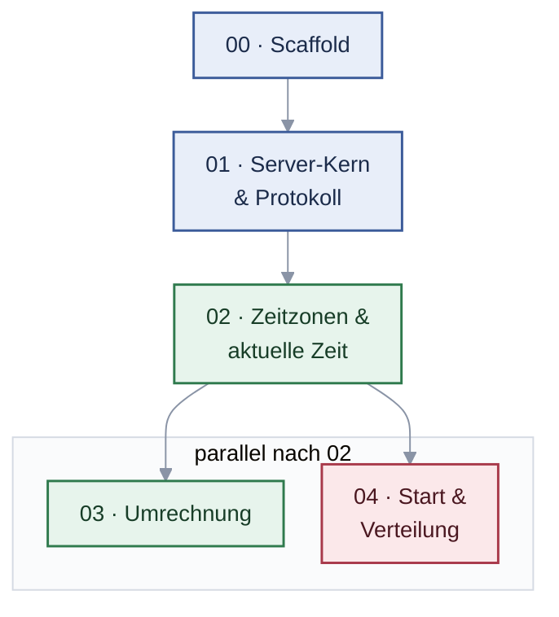
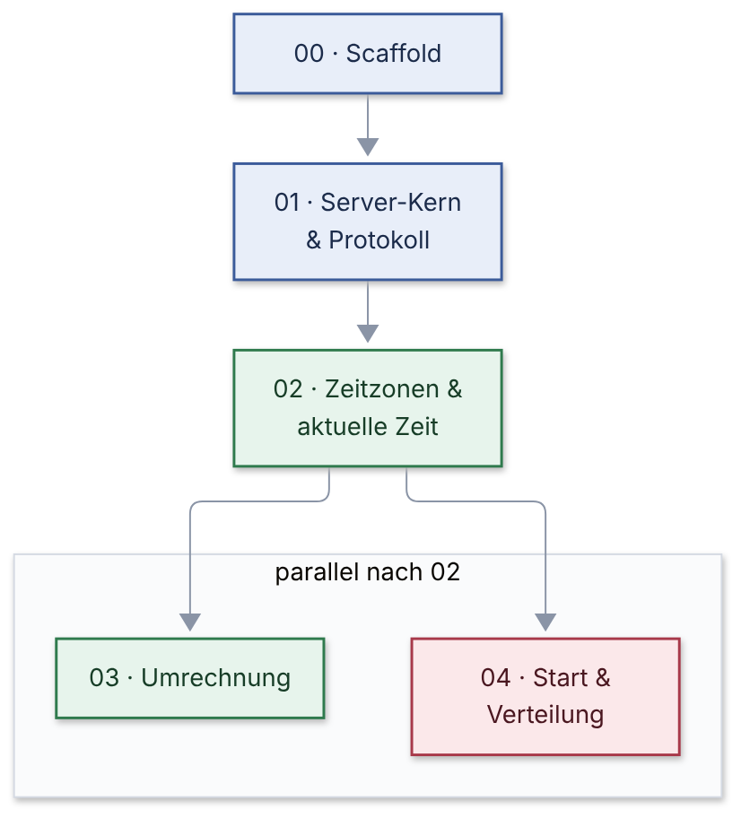

# Rebuild-Plan – mcp-time → .NET 10

Erzeugt mit dem Skill `vibe-rebuild` 2.2.0 am 23.10.2026.
Vorlage: MCP-Referenzserver „time“ (`modelcontextprotocol/servers`, `src/time` @ `51b6382`, Python, MIT). Ziel: derselbe Nutzen, in .NET 10 besser gebaut – keine Kopie.

## Einschätzung: Neubau oder Refactoring?

Das Original ist klein (310 Zeilen), sauber und sehr gut getestet. Ein Refactoring im selben Stack lohnt kaum. Der Neubau in .NET 10 lohnt sich, wenn der Server ins .NET-Ökosystem soll, etwa als `dotnet tool` über `dnx` neben anderen .NET-MCP-Servern. Er bringt außerdem zwei echte Verbesserungen: ein optionales Datum bei der Umrechnung und plattformunabhängig gleiche Zeitzonen-Daten durch NodaTime.

Die Fachlogik ist durch 44 Vergleichsfälle mit exakten Werten abgesichert, darunter Sommerzeit, Viertelstunden-Offsets, Datumsgrenze sowie nicht existierende und doppeldeutige Ortszeiten. Das Risiko ist gering.

## Dateien

| Datei | Inhalt |
|---|---|
| `CLAUDE.md` | Leitplanken (Wurzelordner, lädt Claude Code automatisch) |
| `.claude/commands/rebuild.md` | der Befehl `/rebuild`, der den Rebuild Slice für Slice durchführt |
| `rebuild/analysis.md` | Stack, Domain, Features, Schnittstellen, Tests, Legacy-Befunde |
| `rebuild/research.md` | Zielstack-Recherche: drei Durchgänge, Entscheidungen D1–D20 mit Quellen |
| `rebuild/open-questions.md` | offene Fragen mit markierten Annahmen |
| `rebuild/PRD.md`, `rebuild/GLOSSARY.md` | Verhalten mit Given/When/Then, Verbesserungen mit Absicht, Begriffe |
| `rebuild/slices/00–04` | je Slice Ziel, Umfang, startfertiger Prompt, Definition of Done |
| `rebuild/parity/` | Vergleichsfälle mit exakten Erwartungswerten, Abweichungsprotokoll |
| `rebuild/plans/` | Detailpläne je Slice (entstehen bei `/rebuild`) |
| `rebuild/checklist.md` | Fortschritt je Slice |
| `rebuild/slice-graph*.mmd/.png/.svg` | Abhängigkeitsgraph (Dokument und Seitenleiste) |
| `rebuild/_raw/`, `_inventory.md`, `_slices.json` | Arbeitsmaterial |

## Slice-Abhängigkeiten





Nach Slice 02 können 03 (Umrechnung) und 04 (Start und Verteilung) parallel laufen.

## So geht es weiter

Der ganze Rebuild läuft über einen einzigen Befehl in Claude Code: **`/rebuild`**. Er sucht die nächste Slice aus, legt dir einen Plan vor, baut nach deiner Freigabe Tests und Code und hakt die Slice am Ende ab.

### Voraussetzungen (einmalig)

| Was | Wozu | Prüfen mit |
|---|---|---|
| Claude Code | führt `/rebuild` aus | `claude --version` |
| .NET 10 SDK | baut und testet den Rebuild | `dotnet --version` (10.x) |
| optional: Node.js | nur für den MCP Inspector zum Ausprobieren (`npx @modelcontextprotocol/inspector`) | `node --version` |
| optional: Plugin superpowers | feinere Pläne, ein Subagent pro Aufgabe, Reviews dazwischen | in Claude Code `/plugin` aufrufen und superpowers installieren; `/rebuild` erkennt es selbst |

Das Original brauchst du nicht. Alles, was der Rebuild treffen muss, steht in `rebuild/`. Fehlt etwas, sagt dir `/rebuild` vor Slice 00 genau, was und wie du es behebst.

### Ablauf je Slice

1. **Claude Code im Repo-Ordner starten**: Terminal im Repo-Ordner öffnen und `claude` eingeben.
2. **`/rebuild` eintippen.** Claude nennt die Slice, die als Nächstes dran ist, und warum.
3. **Plan prüfen.** Claude legt den Plan unter `rebuild/plans/` ab und zeigt ihn dir: Dateien, Klassen, Tests. Passt er, antworte zum Beispiel „passt, los“. Sonst sag, was anders sein soll.
4. **Claude baut die Slice**: zuerst Tests, die fehlschlagen, dann den Code, bis alles grün ist, inklusive der Vergleichsfälle aus `rebuild/parity/`. Zwischendurch kommen kurze Statuszeilen.
5. **Abschluss.** Claude hakt die Slice in `rebuild/checklist.md` ab und endet mit drei Zeilen: was fertig ist, welche Slices jetzt startbereit sind, und „neue Session starten, `/rebuild`“.
6. **Neue Session** (neues Terminal oder `/clear`) und wieder `/rebuild`. Jede Slice bekommt eine frische Session, damit der Kontext sauber bleibt.

### Befehle

| Eingabe | Was passiert |
|---|---|
| `/rebuild` | nächste offene Slice, deren Abhängigkeiten erledigt sind |
| `/rebuild 03` | genau Slice 03; fehlt eine Abhängigkeit, fragt Claude nach |
| `/rebuild status` | Übersicht: erledigt, in Arbeit, startbereit, blockiert |
| `/rebuild 03 direct` | ohne superpowers, auch wenn es installiert ist |

### Parallel arbeiten

Nach Slice 02 sind 03 (Umrechnung) und 04 (Start und Verteilung) unabhängig voneinander. Öffne zwei Terminals und tippe `/rebuild 03` bzw. `/rebuild 04`. Jede Slice arbeitet auf ihrem eigenen Branch.

### Wenn etwas hakt

- **Tests bleiben rot**: Die Slice wird nicht abgehakt. Starte eine neue Session mit `/rebuild NN`. Claude setzt beim vorhandenen Branch und Plan wieder an.
- **Ein Vergleichsfall schlägt fehl**: Claude trägt das in `rebuild/parity/deviations.md` ein, entweder als Fehler im Rebuild oder als bewusste Verbesserung mit Begründung.
- **Eine fachliche Frage ist offen**: Sie steht in `rebuild/open-questions.md`. Antworte Claude direkt, die Entscheidung landet in Plan und Spezifikation.
- **Du willst den Stand sehen**: `/rebuild status`.

### Wo steht was

| Ordner/Datei | Inhalt |
|---|---|
| `CLAUDE.md` | Regeln für Claude: Architektur, harte Regeln, Befehle (wird automatisch geladen) |
| `.claude/commands/rebuild.md` | der Befehl `/rebuild` |
| `rebuild/slices/` | eine Datei je Slice: Ziel, Umfang, Definition of Done |
| `rebuild/plans/` | die Detailpläne, die bei jedem `/rebuild` entstehen |
| `rebuild/checklist.md` | Fortschritt |
| `rebuild/PRD.md`, `rebuild/GLOSSARY.md` | gewünschtes Verhalten, Verbesserungen, Begriffe |
| `rebuild/research.md` | technische Entscheidungen mit Quellen |
| `rebuild/parity/` | erwartetes Verhalten aus dem Original (Fälle mit exakten Werten), Abweichungsprotokoll |
| `src/`, `tests/` | der neue Code (entsteht ab Slice 00) |

## Bauen und testen

```bash
dotnet build -warnaserror
dotnet test                                  # alle Tests (Core, Protokoll, Architektur)
dotnet run --project src/McpTime.Host -- --local-timezone Europe/Vienna
dotnet pack src/McpTime.Host -c Release -o artifacts/package      # dotnet tool (D17)
dotnet dnx Vompa.McpTime --source artifacts/package --yes -- --help   # aus dem Paket starten (`--` nötig für --help)
npx @modelcontextprotocol/inspector --cli dotnet run --project src/McpTime.Host --method tools/list
dotnet format --verify-no-changes
```

## Annahmen, die du prüfen solltest

- `convert_time` bekommt ein optionales `date`. Ohne `date` bleibt das Verhalten wie beim Original.
- Fehlertexte werden neu formuliert, die Information bleibt gleich.
- Wochentage bleiben englisch, die Zeitdifferenz bleibt ein String (`+5.75h`).
